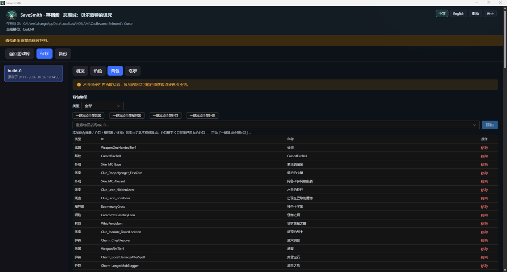
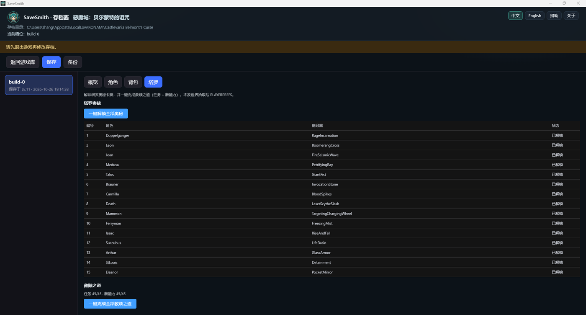
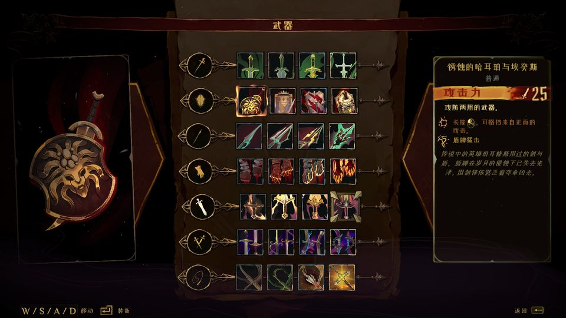
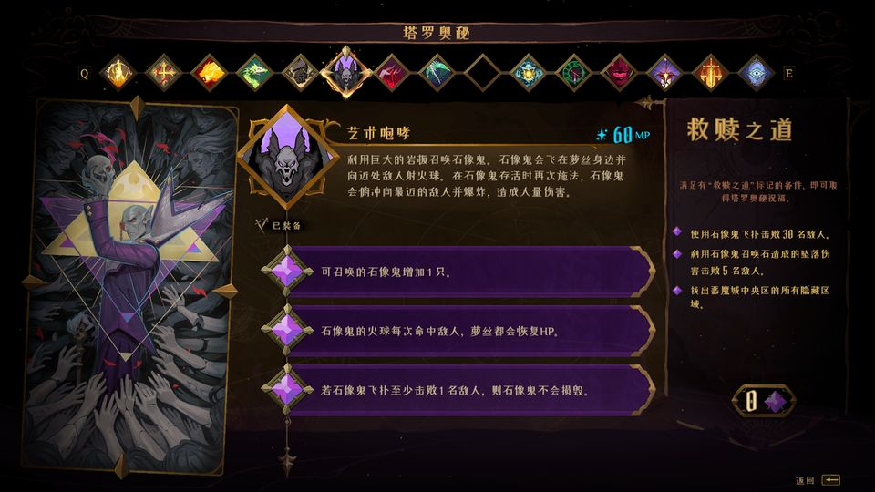

# Castlevania: Belmont's Curse

[中文](belmonts-curse.md) | **English**

Unofficial save-editing notes. Rights holder: **KONAMI** (Steam AppID [4231820](https://store.steampowered.com/app/4231820/)). Not affiliated with the publisher. Module cover uses the Steam store header (© KONAMI).

> **Current scope:** Edits `playerSave` **character scalars**, **inventory / equipment** (when the name catalog is ready), and **Tarot** (Arcana unlock + complete all Works of Mercy) in slot files `BuildSave_*.sav`. No separate Abilities / Exploration tabs. Does **not** read or write `PLAYERPREFS.sav`. Does **not** dual-write `worldSaves` pickup state.

Design: [2026-10-19](../design/2026-10-19-belmonts-curse-design.md) · [Inventory](../design/2026-10-26-belmonts-curse-inventory-design.md)

## Save location

Default (Windows):

`%USERPROFILE%\AppData\LocalLow\KONAMI\Castlevania Belmont's Curse`

Slot files: `BuildSave_0.sav`, `BuildSave_1.sav`, … (typically ~4 slots). SaveSmith **lists and edits only** `BuildSave_*.sav`.

The same folder may contain `PLAYERPREFS.sav` (preferences / DLC-related keys) and `steam_autocloud.vdf`. **This module does not treat them as editable slots and never writes them.**

## Format

- Single-line UTF-8 **JSON**; common top-level keys include `version`, `playerSave`, `worldSaves`, `progressionBoardSave`.
- **No** checksum / HMAC. Unknown keys are **passed through**; only edited whitelist fields change.
- `JSON.stringify` on save may alter whitespace or key order vs. the original file. Success means **the game loads the file** (see [HANDTEST](../HANDTEST.md)).

Steam Cloud syncs `*.sav` in this folder (~40 MiB quota). **Quit the game completely** before editing, and consider **disabling Steam Cloud** for this title so an older cloud copy does not overwrite your edits.

## Editable content (SaveSmith today)

| Tab | Mode | Content |
|-----|------|---------|
| Overview | Read-only summary | `version`, `saveDate`, `playTimeInSeconds`, etc. |
| Character | **Writable** | Whitelist below |
| Inventory | **Writable** (catalog ready) | Add/remove weapons / charms / spells / skins (deduped; skips abstract / Doppelganger / deprecated; **no** clue/key in add list); edit equip slots (must own; charms may be empty) |
| Tarot | **Writable** (`arcana.json` + `mercy.json` ready) | Unlock all 15 Arcana (`characterProgressionSteps` + spells / vania); complete all Works of Mercy (`arcanaCompletedTasks` / `arcanaSeenTasks` / `arcanaUnlockedTalents`) |

### Character scalar whitelist (`playerSave`)

| Field | Constraint |
|-------|------------|
| `level` | integer ≥ 1 |
| `experienceCurrent` | integer ≥ 0 |
| `healthUpgradeFragmentCount` | integer ≥ 0 |
| `manaUpgradeFragmentCount` | integer ≥ 0 |
| `atkBonusUpgradeCount` | integer ≥ 0 |
| `defBonusUpgradeCount` | integer ≥ 0 |
| `currentTheHermitDeathDefianceCount` | integer ≥ 0 |

These are shown but **not editable** (edits would not stick): `currentHealth`, `currentMana`, `currentHealChargesCount`.  
Reason: continuing from a **Mirror of Life** restores full HP/MP and refill heal charges, so runtime vitals in the save are overwritten on a normal load. Level / XP / upgrade fragments are persistent, so they stick. To raise HP/MP **caps**, edit the upgrade fragment fields—not current values.

Everything else (including `worldSaves`, `progressionBoardSave`) is **passed through unchanged**. **World pickup state is not synced** — items added in the editor may still be pickable again at their original locations.

Automatic backups (last 10 per file) before save; restore from the backup panel.

### Screenshots

| SaveSmith inventory | SaveSmith Tarot |
|:---:|:---:|
|  |  |

| In-game weapons | In-game Works of Mercy |
|:---:|:---:|
|  |  |

## Usage notes

1. **Fully quit the game** before editing (quit may rewrite `BuildSave_*.sav`).
2. Consider **turning off Steam Cloud** for this game until you verify edits stick.
3. Use a **copy** of your save for first trials—not your only live slot.
4. Loading at a Mirror of Life restores full HP / MP / heal charges; editing those current values usually does not persist — prefer upgrade-fragment fields.
5. For legitimate owners, **offline single-player** study only; do not use online or distribute modified saves.
6. After major game updates, JSON shape or `version` may drift; see the module and [CHANGELOG](../../CHANGELOG.en.md).

## Developers

- Module: `src/games/belmonts-curse/`
- Name / Arcana catalogs: `py -3 scripts/bc_extract_names.py --game "<install root>"` (requires UnityPy; writes `items.json` + `arcana.json`)
- Works of Mercy GUIDs: `py -3 scripts/_bc_dump_mercy_catalog.py` (writes `catalog/mercy.json`)
- Tests: `npx vitest run tests/belmonts-curse`

Back to [README](../../README.en.md).
