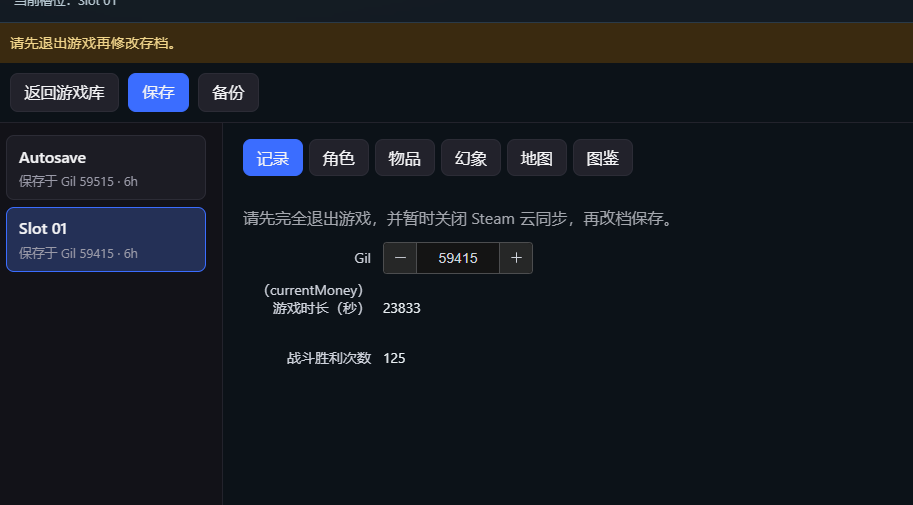
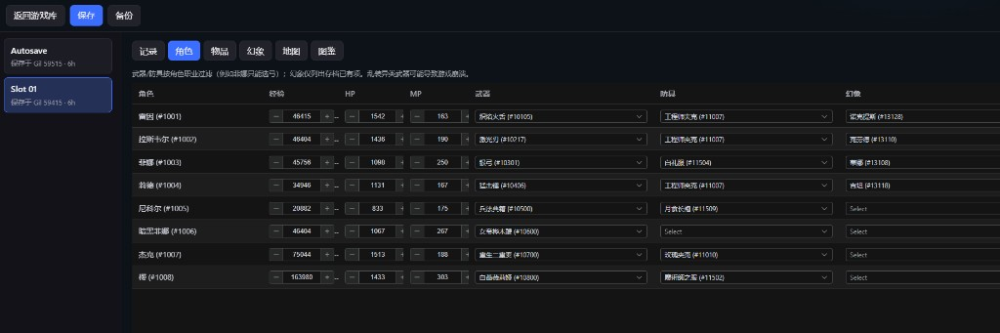
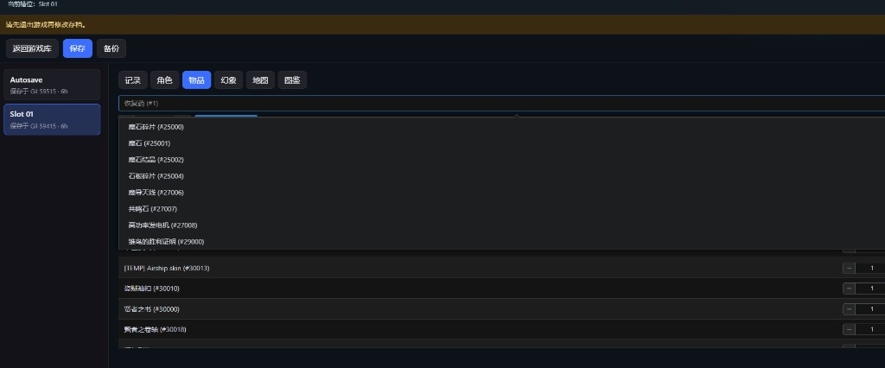
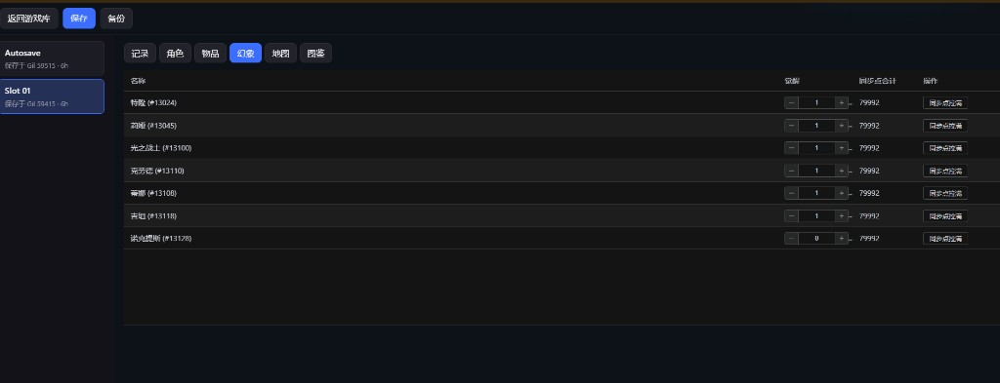
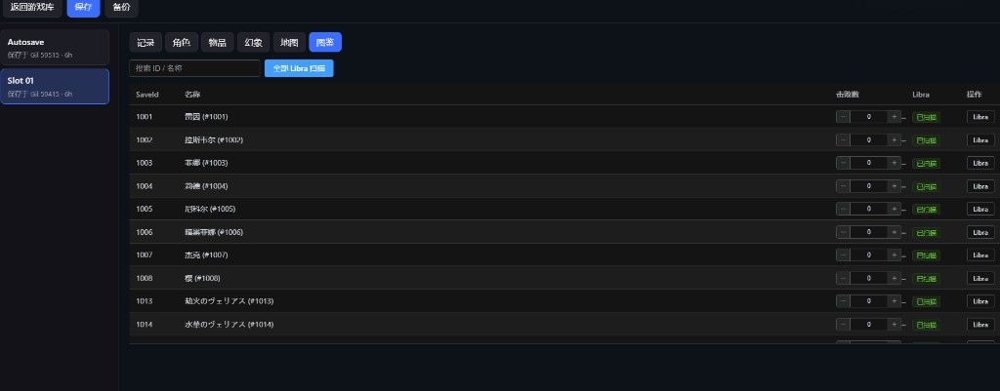

# 最终幻想：共鸣（FINAL FANTASY RESONANCE）

非官方存档修改支持。权利人：Square Enix；开发：LANCARSE。Steam AppID `3259780`。

## 存档位置

`%LOCALAPPDATA%\FFRS\Steam\<SteamID64>\`

| 文件 | 说明 |
|------|------|
| `GameSaveData0.sav` | 自动档 |
| `GameSaveDataN.sav` | 手动槽 N |
| `OptionSaveData.sav` / `EnhancedInputUserSettings.sav` | **不修改** |

格式：`SVHD` 头 + AES-256-ECB 体 + SHA-1；解密后为 UE5.5+ GVAS。

## 可编辑

- **记录**：Gil（`Player.currentMoney`）、时长/胜场只读展示
- **角色**：经验、HP、MP；武器/防具/幻象为**名称下拉**（按职业过滤，避免异类武器坏档）
- **物品**：改数量；按名称下拉新增（数量钳制 0–99）
- **幻象**：觉醒等级、同步点拉满
- **地图**：已知 / 已访问 / 已通关
- **图鉴**：`unitList` 击败数、Libra（`IsAnalyzed` + `analyzedElments`）
- **快捷动作**：Gil 拉满、**补全装备/消耗品**、**补全幻象**、**材料包**、地图全知、全部 Libra、商店限购重置、重置已开宝箱

名称表：`catalog/names.json`（`en` 社区公开表；`zh` 为已核对简中 / FF 经典译名，假名不顶中文；装备过滤见 `catalog/equipment.json`）。数据来源见模块内 `catalog/SOURCE.md`。

### 截图

| 记录 | 角色 | 物品 |
|:---:|:---:|:---:|
|  |  |  |

| 幻象 | 图鉴 |
|:---:|:---:|
|  |  |

## 注意

1. **先完全退出游戏**，建议暂时关闭 Steam 云同步。
2. 宿主会做备份；仍建议先复制存档目录。
3. 本工具与 Square Enix / LANCARSE 无关。
4. 格式说明曾参考社区开源工具 [ffr-save-editor](https://github.com/jesus-seijas-sp/ffr-save-editor)（MIT）的公开 README；实现为 Clean-room，未复制其源码。
5. `cover.jpg` 取自 Steam 商店头图（App `3259780`），版权属 Square Enix / LANCARSE，仅作存档酱库页识别用。
